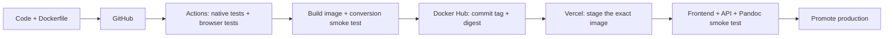

# FlowKit deployment

The workflow in `.github/workflows/deploy.yml` implements:



Pull requests and branch pushes run checks. Only pushes to `main` publish and deploy. Keep feature branches unmerged until ready. Configure the `checks` job as a required branch check. The image and deploy jobs use the GitHub `production` environment; restrict it to `main` and configure reviewers as appropriate for your account.

## Account setup

1. Create a **public** GitHub repository named **Flowkit** under your account, leaving README, `.gitignore`, and license unchecked. The local repository has no remote yet. Add its URL as `origin`, then push the feature branches you want to review. Do not merge just to test the configuration.
2. Create a **public** Docker Hub repository named `flowkit`. This initial pipeline requires a public image because Vercel's build pulls the digest without Docker Hub credentials. Everything copied into the runtime image is public; `.dockerignore` excludes local secrets, Git history, tools, and archived plans. Do not use this setup if publishing runtime source is unwanted.
3. Create/select a Vercel project named `flowkit` with the **Container** framework preset. Keep automatic Git deployments disconnected: GitHub Actions owns deployment so failed checks cannot be bypassed by a parallel Git deployment.
4. Set Vercel runtime `PORT=3000`. Enable automatic exposure of system environment variables so `VERCEL_URL` and `VERCEL_PROJECT_PRODUCTION_URL` reach the container. Keep deployment protection enabled for the hackathon demo; the app has no user accounts yet.
5. Configure GitHub's `production` environment using the table below. Enter tokens directly into GitHub Secrets, never into chat or committed files.

| Kind | Name | Value |
| --- | --- | --- |
| Variable | `DOCKERHUB_USERNAME` | Your Docker Hub login |
| Variable | `DOCKERHUB_REPOSITORY` | `<dockerhub-login>/flowkit` |
| Variable | `VERCEL_ORG_ID` | Selected Vercel team/account ID |
| Variable | `VERCEL_PROJECT_ID` | Selected `flowkit` project ID |
| Variable | `PUBLIC_ORIGINS` | Exact production origin, e.g. `https://your-flowkit.vercel.app`; comma-separated if multiple, with no spaces or trailing slash |
| Secret | `DOCKERHUB_TOKEN` | Docker Hub access token with push access to this repository |
| Secret | `VERCEL_TOKEN` | Vercel token scoped to the intended account/team |
| Secret | `VERCEL_AUTOMATION_BYPASS_SECRET` | Project protection automation bypass secret for the staged smoke test; needed if protection is enabled |

Vercel system URLs permit the unique staged deployment hostname; `PUBLIC_ORIGINS` permits production aliases/custom domains. Hostnames and browser origins are checked exactly. Forwarded headers do not grant access. These checks are not authentication: keep deployment access protected until accounts and quotas exist.

## Test locally with Docker

```sh
docker build --platform linux/amd64 -t flowkit:local .
docker run --rm --name flowkit-local -p 127.0.0.1:4318:3000 flowkit:local
```

In another terminal:

```sh
node scripts/smoke.mjs http://127.0.0.1:4318
```

The image runs as an unprivileged user, includes Pandoc, ImageMagick, and FFmpeg, serves the built frontend and API, and uses temporary files only for active operations. `IMAGEMAGICK_PATH=/usr/bin/convert` selects Debian's ImageMagick 6 executable in both build and runtime stages. Node dependencies used only by the frontend are compiled into `dist`; the runtime server uses Node's built-ins. PDF binaries will join the image when their adapters are implemented. The smoke test verifies document conversion, PNG resizing, and FFmpeg audio conversion before promotion.

## Why the Vercel deployment is a second tiny build

Vercel supports OCI images as autoscaling Functions. CI generates an ignored `.deployment/Dockerfile.vercel` containing only `FROM docker.io/<account>/flowkit@sha256:<digest>`. Vercel imports that tested image into its registry; application source is not rebuilt there. The remote container build is intentional, so this pipeline does not use `vercel deploy --prebuilt`, which deploys Vercel Build Output API artifacts rather than a Docker image.

The staged deployment uses production environment settings without moving the production domain. A full sample conversion must succeed before `vercel promote` runs. A failed smoke test leaves the previous production deployment serving traffic. If the first deployment fails, inspect the Vercel build/runtime logs and verify system URL exposure, origin settings, port, and protection bypass configuration.

To roll back an already-promoted release, use Vercel's deployment dashboard or `vercel rollback` for the linked project. After a rollback, explicitly promote a known-good deployment when resuming releases. Keep immutable Docker digests for releases you may restore; do not rely on `latest`.

## Current limits

This is deployment infrastructure for the current hackathon app, not a completed multi-user production service. Workflows and artifacts are not persisted, and the one-run-at-a-time guard applies per container instance, not across the fleet. Native conversion is request-bound; durable queues and workers belong in a later feature.

The local adapter accepts 20 MiB, but Vercel Functions have a **4.5 MB request-body cap**. Base64 adds about one third, so use files below roughly **3 MB** for this deployed demo. Direct object-storage uploads and authorized artifact references are required before promising 20 MiB cloud uploads. Vercel execution/memory limits still apply to container Functions.

References: [Vercel Container Runtime](https://vercel.com/docs/functions/runtimes/container), [Function limits](https://vercel.com/docs/functions/limitations), [staging/promoting deployments](https://vercel.com/docs/cli/promote).
