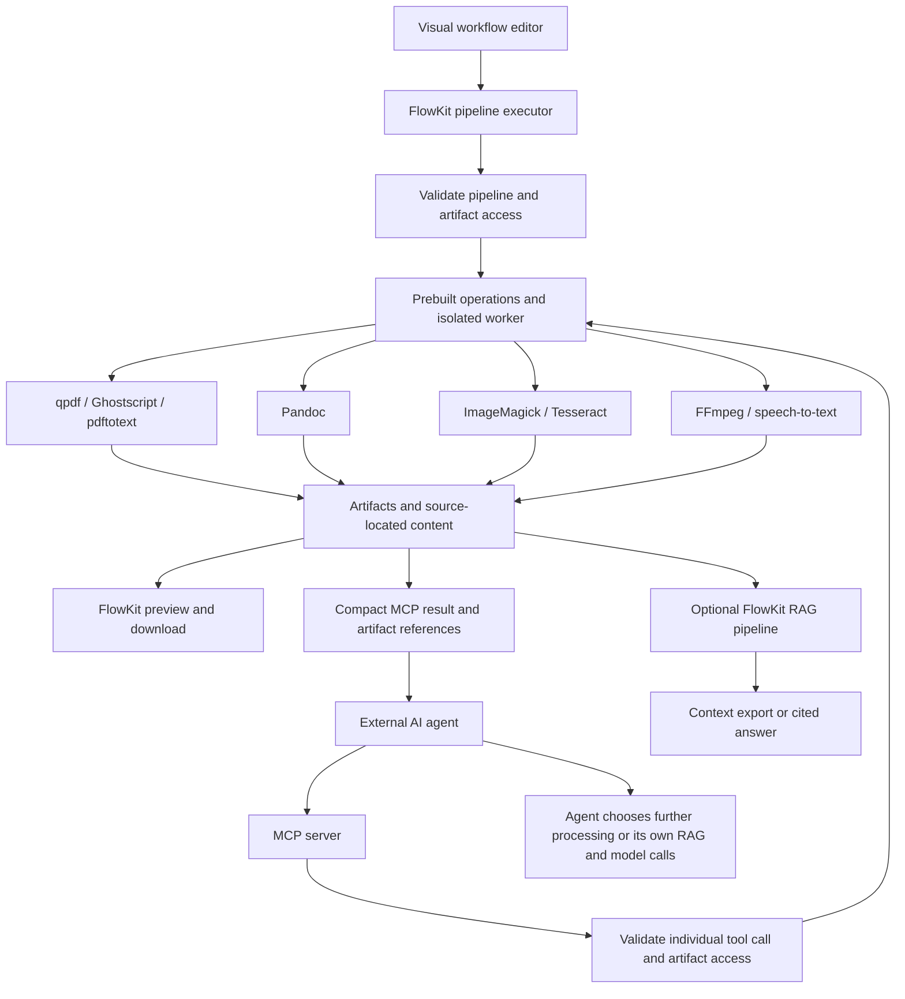
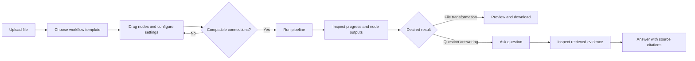
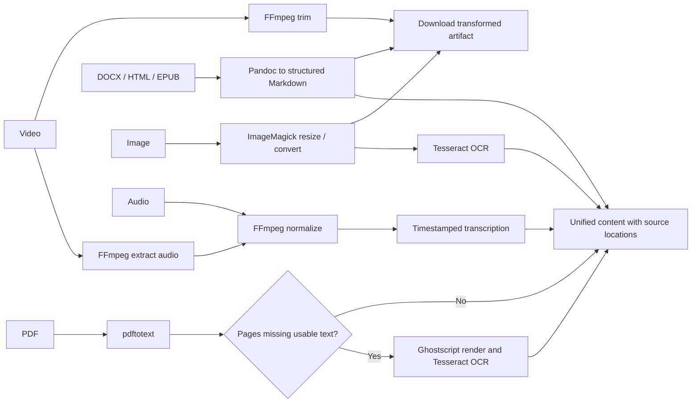
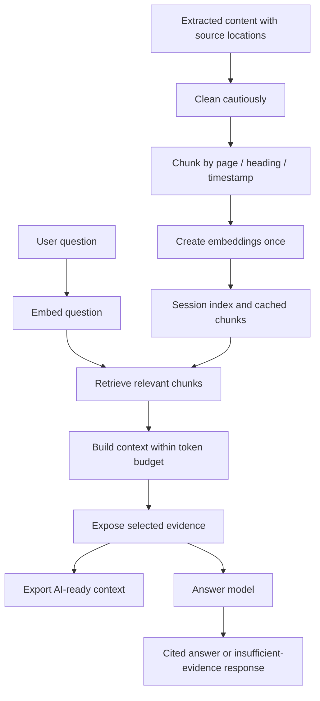
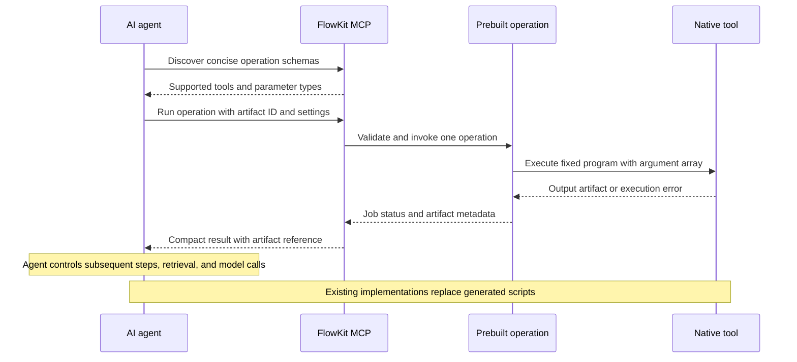
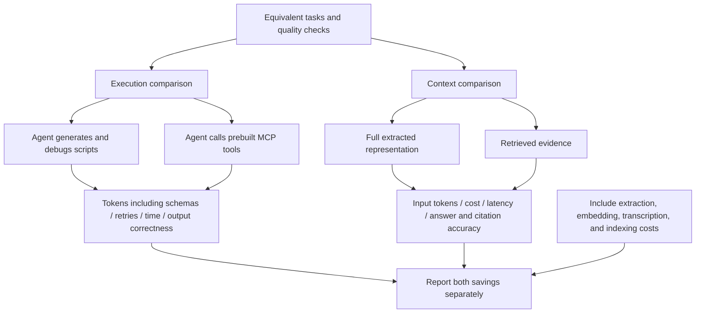
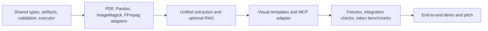

# FlowKit diagrams

Diagram definitions prepared for the FlowKit Miro board. These have not yet been published to Miro.

## 1. Platform architecture

## 2. User journey

## 3. File-specific templates

## 4. RAG lifecycle

## 5. MCP operation execution

## 6. Token-savings evaluation

## 7. Hackathon build sequence

