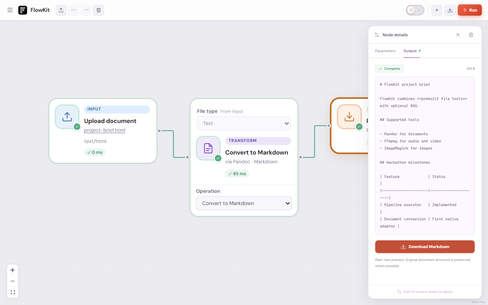
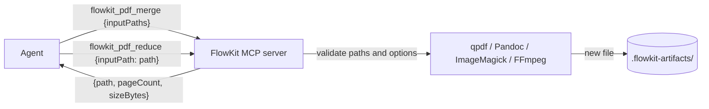
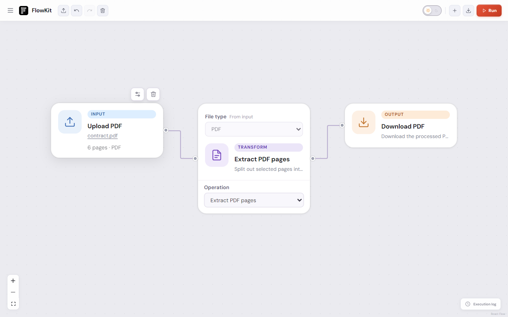
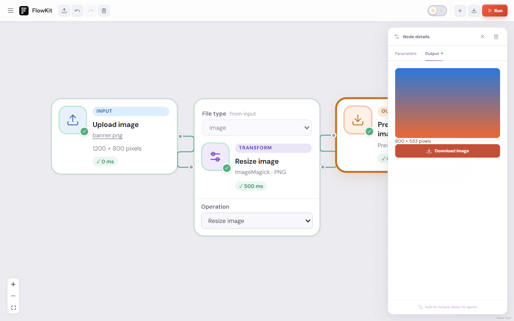

<div align="center">


# FlowKit

**46 local file tools for AI agents: documents, PDFs, images, audio, and video. Plus a visual workflow studio.**

[](https://www.npmjs.com/package/flowkit-mcp)
[](https://www.npmjs.com/package/flowkit-mcp)
[](https://github.com/ayusht9/Flowkit/actions/workflows/deploy.yml)
[](LICENSE)
[](https://nodejs.org)
[](https://modelcontextprotocol.io)

[Website](https://ayusht9.github.io/Flowkit/) · [Workflow studio](https://flowkit-ruddy.vercel.app) · [Tool reference](MCP.md) · [Benchmarks](docs/BENCHMARKS.md) · [Changelog](CHANGELOG.md)

</div>

FlowKit is an [MCP](https://modelcontextprotocol.io) server that gives Claude, Codex, Cursor, VS Code, and other agents ready-made tools for everyday file work: convert a DOCX to Markdown, merge and shrink PDFs, resize images, trim audio and video. Tools run **on your machine** with Pandoc, qpdf, Ghostscript, ImageMagick, and FFmpeg. Instead of writing and debugging a script for each job, the agent sends one short tool call.

<table>
<tr>
<td align="center"><b>~80% fewer tokens</b><br><sub>per file task vs. a hand-written script</sub></td>
<td align="center"><b>65–77% fewer</b><br><sub>on multi-step workflows</sub></td>
<td align="center"><b>46 / 47 tool runs pass</b><br><sub>on real files, 1 optional engine skipped</sub></td>
<td align="center"><b>6 / 6 safety checks</b><br><sub>path escapes and bad input blocked</sub></td>
</tr>
</table>

<sub>Numbers from <code>npm run benchmark</code>, 2026-11-22. See <a href="docs/BENCHMARKS.md">the full benchmark report</a> for method and caveats.</sub>

<picture>
  <source media="(prefers-color-scheme: dark)" srcset="docs/screenshots/workflow-studio-dark.png">
  
</picture>

## Contents

- [Quick start](#quick-start)
- [Connect your agent](#connect-your-agent)
- [What's included](#whats-included)
- [Benchmarks](#benchmarks)
- [How it works](#how-it-works)
- [Workflow studio](#workflow-studio)
- [Configuration](#configuration)
- [Troubleshooting](#troubleshooting)
- [Development](#development)
- [License](#license)

## Quick start

**1. Install** (requires [Node.js](https://nodejs.org) 22.12 or newer):

```sh
npm install --global flowkit-mcp
```

**2. Install the native engines** for the tools you plan to use. You don't need all of them.

| Engine | Used for | macOS | Ubuntu / Debian | Windows |
| --- | --- | --- | --- | --- |
| [Pandoc](https://pandoc.org/installing.html) | Documents | `brew install pandoc` | `sudo apt install pandoc` | `winget install JohnMacFarlane.Pandoc` |
| [qpdf](https://github.com/qpdf/qpdf/releases) | PDF pages, encryption | `brew install qpdf` | `sudo apt install qpdf` | `winget install QPDF.QPDF` |
| [Ghostscript](https://ghostscript.com/releases/gsdnld.html) | PDF size reduction | `brew install ghostscript` | `sudo apt install ghostscript` | `winget install ArtifexSoftware.GhostScript` |
| [ImageMagick](https://imagemagick.org/script/download.php) | Images | `brew install imagemagick` | `sudo apt install imagemagick` | `winget install ImageMagick.ImageMagick` |
| [FFmpeg](https://ffmpeg.org/download.html) | Audio and video | `brew install ffmpeg` | `sudo apt install ffmpeg` | `winget install Gyan.FFmpeg` |

Tested with Pandoc 3.13, qpdf 12.2.0, Ghostscript 10.08.0, ImageMagick 7.1.1, and FFmpeg 9.0.2. Document → PDF export also needs pdfroff (GNU groff).

**3. Check your setup.** The workspace is the folder FlowKit may read from and write to:

```sh
flowkit-mcp --doctor --workspace /path/to/files
```

```text
FlowKit MCP 0.3.1: installed
Workspace: /path/to/files
pandoc: ready - pandoc 3.13
imagemagick: ready - Version: ImageMagick 7.1.1-47 Q16-HDRI x64
ffmpeg: ready - ffmpeg version 9.0.2
ffprobe: ready - ffprobe version 9.0.2
qpdf: ready - qpdf version 12.2.0
ghostscript: ready - 10.08.0
Processing tools: ready
```

**4. Connect your agent** (below), then ask it something like *"Merge cover.pdf and report.pdf, then shrink the result to half its size."*

> [!TIP]
> On Windows, if PowerShell blocks the command, use `flowkit-mcp.cmd` (and `npm.cmd`). Or skip the global install and run it with `npx -y flowkit-mcp`.

## Connect your agent

Replace `/path/to/files` with an absolute path to a folder that holds only the files you want processed.

<details open>
<summary><b>Claude Code</b></summary>

```sh
claude mcp add --transport stdio flowkit -- flowkit-mcp --workspace /path/to/files
claude mcp list
```
</details>

<details>
<summary><b>Claude Desktop</b></summary>

Open **Settings → Developer → Edit Config**, add this to `claude_desktop_config.json`, and restart Claude:

```json
{
  "mcpServers": {
    "flowkit": {
      "command": "flowkit-mcp",
      "args": ["--workspace", "/path/to/files"]
    }
  }
}
```
</details>

<details>
<summary><b>Codex CLI</b></summary>

```sh
codex mcp add flowkit -- flowkit-mcp --workspace /path/to/files
codex mcp list
```
</details>

<details>
<summary><b>Cursor</b></summary>

Add the Claude Desktop JSON above to `.cursor/mcp.json` (one project) or `~/.cursor/mcp.json` (all projects).
</details>

<details>
<summary><b>VS Code (GitHub Copilot)</b></summary>

Create `.vscode/mcp.json`:

```json
{
  "servers": {
    "flowkit": {
      "type": "stdio",
      "command": "flowkit-mcp",
      "args": ["--workspace", "${workspaceFolder}"]
    }
  }
}
```
</details>

<details>
<summary><b>Google Antigravity</b></summary>

Copy [`clients/agy.mcp_config.json`](clients/agy.mcp_config.json) to `<workspace>/.agents/mcp_config.json`, set the workspace path, and open `/mcp` to check the connection.
</details>

<details>
<summary><b>Any other MCP client</b></summary>

Configure a **stdio** server with command `flowkit-mcp` and arguments `--workspace /path/to/files`. No API keys or network access are needed; your client provides the model. To try the tools interactively:

```sh
npx @modelcontextprotocol/inspector flowkit-mcp --workspace /path/to/files
```
</details>

### Companion agent skill

[`skill/flowkit/`](skill/flowkit/SKILL.md) is an [Agent Skill](https://agentskills.io) that teaches your agent when to use FlowKit, how to chain tools, and how to set FlowKit up if it's missing. To install it in Claude Code, copy the folder to `~/.claude/skills/flowkit/` (or `.claude/skills/flowkit/` in a project). Other skill-aware agents use the same folder. Build a zip for skill marketplaces with `npm run skill:pack`.

## What's included

| Group | Tools | Engine |
| --- | --- | --- |
| **Always available** | `list_files`, `read_text`, `file_metadata` | Node.js, mixed |
| **Documents** (`--tools document`) | `document_to_markdown`, `_html`, `_docx`, `_odt`, `_epub`, `_pdf`, `_text`, `_rtf`, `_latex`, `_rst`, `_asciidoc`, `_pptx`, `clean_markdown`, `merge_documents` | Pandoc |
| **PDF** (`--tools pdf`) | `pdf_merge`, `pdf_extract`, `pdf_rotate`, `pdf_remove`, `pdf_reverse`, `pdf_reduce`, `pdf_encrypt`, `pdf_decrypt`, `pdf_sign` | qpdf, Ghostscript |
| **Images** (`--tools image`) | `image_resize`, `image_crop`, `image_rotate`, `image_flip`, `image_grayscale`, `image_blur`, `image_sharpen`, `image_convert` | ImageMagick |
| **Audio** (`--tools audio`) | `audio_convert`, `audio_trim`, `audio_volume`, `audio_fade`, `audio_normalize` | FFmpeg |
| **Video** (`--tools video`) | `video_trim`, `video_convert`, `video_resize`, `video_rotate`, `video_flip`, `video_mute`, `video_extract_audio` | FFmpeg |

Every tool name starts with `flowkit_`, for example `flowkit_pdf_merge`. Arguments, limits, and results for each tool are in the **[tool reference (MCP.md)](MCP.md#tools)**.

## Benchmarks

The benchmark compares two ways an agent can do the same file task:

- **Own script:** the agent writes a compact, safe Node.js script (path checks, timeouts, no overwrites), runs it, and reads the output.
- **FlowKit:** the agent sends one tool call and reads FlowKit's JSON result.


FlowKit has one up-front cost: the client sends the tool list to the model when it connects (about 6,100 tokens for all 46 tools). Loading only the groups you need with `--tools` cuts that to about 1,300–2,000 tokens.


| | Own scripts | FlowKit, all tools | FlowKit, one group |
| --- | ---: | ---: | ---: |
| 1 task | **507** | 6,169 | 1,769 |
| 10 tasks | 5,073 | 7,081 | **2,681** |
| 30 tasks | 15,219 | 9,107 | **4,707** |
| Break-even | — | 15 tasks | 4–6 tasks |

For a single one-off task, a script is cheaper. With a few file tasks in a session, FlowKit pays off, and clients that load tool definitions on demand pay even less of the up-front cost.

FlowKit also keeps large outputs out of the model's context. A converted document comes back as a path plus a 1,000-character preview, which is **98.7% fewer tokens** than reading the whole file. Binary files are never base64-encoded into results.

The **[full report](docs/BENCHMARKS.md)** also covers multi-step workflows, failed attempts, cost per tool group, timing for every tool, and safety checks. Run it yourself:

```sh
npm run benchmark                  # full report, charts, and site data (needs the native engines)
npm run benchmark -- --tokens-only # token scenarios only
npm run benchmark:mcp              # quick token summary in the terminal
```

Token counts are estimated as bytes ÷ 4, not provider billing data.

## How it works



- **Chaining:** every processing tool writes a new file under `.flowkit-artifacts/` in the workspace and returns its `path`. The agent passes that path to the next tool.
- **Small results:** results carry metadata (size, dimensions, duration, page count) and at most a 1,000-character text preview. Agents read more with `flowkit_read_text` only when they need to.
- **Safety:** paths must stay inside the workspace, including after symlinks are resolved. Arguments are schema-validated and unknown ones are rejected. Engines run without a shell, with fixed arguments, timeouts, and size limits. Source files are never overwritten. Passwords are read from files, never passed as arguments. See [SECURITY.md](SECURITY.md).

Example conversation: *"Convert report.docx to Markdown, clean it up, and show me the first part."*

```text
flowkit_document_to_markdown({ inputPath: "report.docx" })
  → { path: ".flowkit-artifacts/run-ABC123/report.md", sizeBytes: 21480, preview: "# Quarterly report…" }
flowkit_clean_markdown({ inputPath: ".flowkit-artifacts/run-ABC123/report.md" })
  → { path: ".flowkit-artifacts/run-DEF456/report.md", … }
flowkit_read_text({ inputPath: ".flowkit-artifacts/run-DEF456/report.md", limit: 2000 })
```

## Workflow studio

The same operations run in a browser-based, drag-and-drop editor. Upload a file, connect **Process**, **Pipe**, and **Download** nodes, and click **Run**. FlowKit detects the file type, shows metadata on the upload node, and previews results. Workflows can be saved locally or exported as JSON.

| PDF uploads switch to PDF tools automatically | Image resize with result preview |
| --- | --- |
|  |  |

Try the [hosted demo](https://flowkit-ruddy.vercel.app) (no accounts; don't upload confidential files), or run it locally:

```sh
git clone https://github.com/ayusht9/Flowkit.git
cd Flowkit
npm install
npm run dev          # http://127.0.0.1:3000
```

For a production build, run `npm run build && npm start`. Container and Vercel deployment are covered in [DEPLOYMENT.md](DEPLOYMENT.md).

## Configuration

| Option | Default | Description |
| --- | --- | --- |
| `--workspace <dir>` | required | Folder FlowKit may read and write. Outputs go to `<dir>/.flowkit-artifacts/`. |
| `--tools <groups>` / `FLOWKIT_TOOLS` | `all` | Comma-separated groups to load: `document`, `pdf`, `image`, `audio`, `video`. |
| `FLOWKIT_MEDIA_MAX_OUTPUT_MIB` | `8` | Maximum audio/video output size (1–256 MiB). |
| `PANDOC_PATH`, `QPDF_PATH`, `GHOSTSCRIPT_PATH`, `IMAGEMAGICK_PATH`, `FFMPEG_PATH`, `FFPROBE_PATH` | found on `PATH` | Custom engine locations. |
| `--doctor [--json]` | | Check the install, workspace, and engines. |
| `--setup` | | Print engine installation guidance. |

Set environment variables in your MCP client's `env` block, for example `"env": { "FLOWKIT_TOOLS": "pdf,image" }`. Default limits: inputs up to 20 MiB, outputs up to 8 MiB, PDFs up to 1,000 pages, images up to 16 megapixels, audio/video up to 5 minutes and 1080p at 60 fps.

## Troubleshooting

| Problem | Fix |
| --- | --- |
| The client can't start the server | Run the same command with `--doctor` in a terminal. On Windows, use `flowkit-mcp.cmd` or `npx -y flowkit-mcp` as the command. |
| "engine missing" or a tool fails immediately | `--doctor` shows what's missing. Install it, or point to it with the `*_PATH` variables above. |
| "Path must stay inside the configured workspace" | Use paths relative to the workspace, or the `path` a previous tool returned. |
| New tools don't appear after upgrading | Restart your MCP client, and check that `--tools` isn't limiting the groups. |
| `document_to_pdf` fails | Install pdfroff (GNU groff) and Ghostscript. Other formats only need Pandoc. |

More answers are in the [tool reference](MCP.md#troubleshooting). If you're still stuck, [open an issue](https://github.com/ayusht9/Flowkit/issues/new/choose) and include your `--doctor` output.

## Development

```sh
npm install
npm test                 # unit and integration tests (native-engine tests skip if an engine is missing)
npm run build            # production build of the workflow studio
npm run test:e2e         # browser tests (Playwright)
npm run benchmark        # regenerate docs/BENCHMARKS.md, charts, and site data
npm run screenshots      # regenerate README and site screenshots (after npm run build)
```

Project layout: `mcp-server.mjs` (CLI), `src/` (MCP server, operation registry, engine adapters), `web/` (workflow studio), `site/` (landing page), `benchmarks/` (benchmark suite), and `test/` + `e2e/` (tests).

Contributions are welcome. Please read [CONTRIBUTING.md](CONTRIBUTING.md) first, and report security issues privately as described in [SECURITY.md](SECURITY.md).

**Limitations:** FlowKit doesn't yet isolate engines in a container or sandbox, and it doesn't provide OCR, PDF editing, remote (HTTP) MCP, or accounts.

## License

[MIT](LICENSE) © 2026 Ayush
