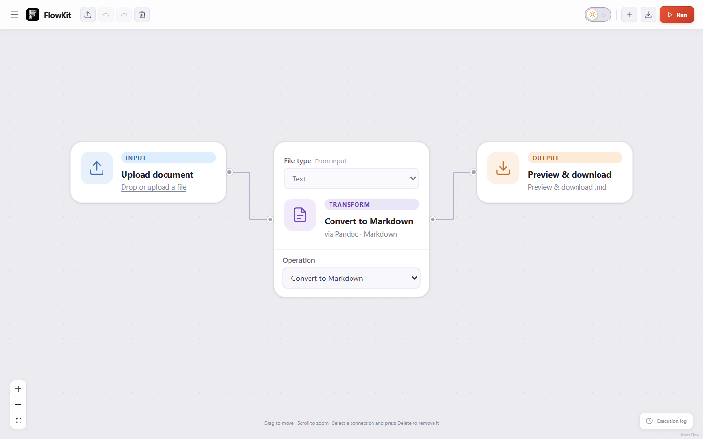
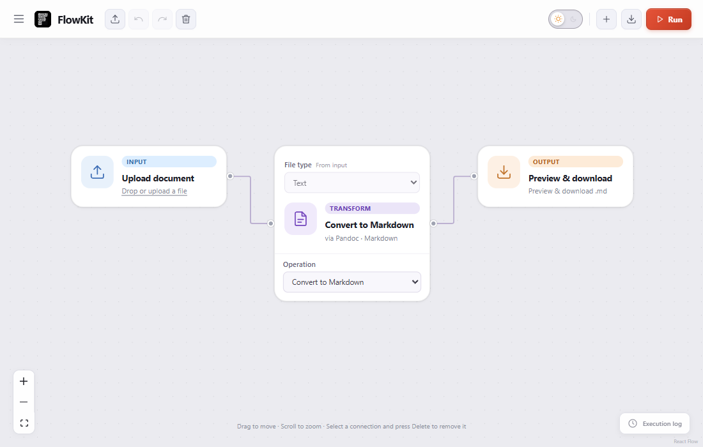

# FlowKit

Local, visual workflows for documents, images, audio, and video — plus an MCP server that lets LLMs call the same tools.





## What you can do

- Build a linear drag-and-drop workflow in the browser.
- Convert DOCX, ODT, HTML, EPUB, and Markdown with Pandoc.
- Resize PNG and JPEG images with ImageMagick.
- Trim and convert audio/video with FFmpeg.
- Run the same operations from an MCP-compatible client.
- Save workflows locally, or export/import workflow JSON.

## Quick start

### 1. Install prerequisites

- [Node.js 22.12+](https://nodejs.org/)
- [Pandoc](https://pandoc.org/installing.html) — document workflows
- [ImageMagick 7](https://imagemagick.org/script/downloads.php) — image workflows
- [FFmpeg](https://ffmpeg.org/download.html) — audio/video workflows

Make sure `pandoc`, `magick` (or `convert` on Linux), `ffmpeg`, and `ffprobe` are available on your `PATH`. You can also configure explicit executable paths with `PANDOC_PATH`, `IMAGEMAGICK_PATH`, `FFMPEG_PATH`, and `FFPROBE_PATH`.

### 2. Install and run

```sh
git clone https://github.com/ayusht9/Flowkit.git
cd Flowkit
npm install
npm run dev
```

Open [http://127.0.0.1:3000](http://127.0.0.1:3000). On Windows PowerShell, use `npm.cmd run dev` if your execution policy blocks `npm.ps1`.

### 3. Run a workflow

1. Choose a starter workflow, or use **New** to start with a blank, text/document, image, audio, or video template.
2. Upload a file, then connect **Process**, **Pipe**, and **Download** nodes on the canvas.
3. Click **Run**. Inspect the result in the output panel, then export or download it.

The default workflow is:

```text
Upload document → Convert to Markdown → Clean Markdown → Preview & download
```

## MCP server

FlowKit also exposes local document, image, audio, and video operations over MCP stdio.

```sh
npm run mcp:doctor
npm run mcp
```

Use [mcp.example.json](mcp.example.json) as a starting point for your MCP host. See [MCP.md](MCP.md) for the tool catalog, configuration, limits, and token benchmark.

## Production build

```sh
npm run build
npm start
```

The server binds to `127.0.0.1` by default. Container deployments should set `HOST=0.0.0.0` and configure `PUBLIC_ORIGINS`. This project has no accounts or persistent cloud storage; uploaded files and execution results stay local to the running server. Cloud uploads should remain below roughly 3 MB when using Vercel Functions.

## Verify your setup

```sh
npm test
node examples/pipeline.mjs
npm run build
npm run test:e2e
```

Native-tool tests report explicit skips when Pandoc, ImageMagick, or FFmpeg is unavailable. Run `npm run mcp:doctor` to check the MCP installation and native dependencies.

## Useful examples

```sh
node examples/document.mjs
node examples/document.mjs "C:\\path\\to\\report.docx"
node examples/pipeline.mjs
```

For adapter contracts, limits, deployment, and the full media/document behavior, see:

- [MCP guide](MCP.md)
- [Deployment guide](DEPLOYMENT.md)
- [Media pipeline notes](docs/MEDIA_PIPELINES.md)

## Project boundaries

FlowKit executes trusted native adapters locally. It does not yet provide OS/container worker isolation, persistent artifact storage, PDF editing, PDF-to-text OCR, authenticated remote MCP, or accounts. Original planning material remains in the ignored [`archieve/`](archieve/) folder.

## Development workflow

Use `develop` for integration and `main` for completed work. Create temporary feature branches from `develop`, verify and commit them, merge into `develop`, then merge the verified result into `main`. Keep `develop` synchronized with `main`; deployments are manual.
