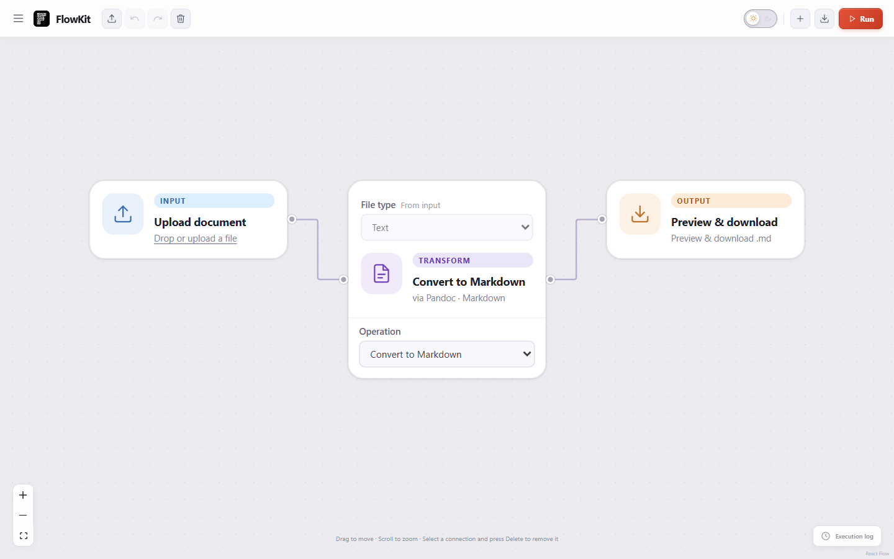

# FlowKit

[](https://github.com/ayusht9/Flowkit/actions/workflows/pages.yml) [](https://github.com/ayusht9/Flowkit/actions/workflows/deploy.yml) [](https://www.npmjs.com/package/flowkit-mcp) [](https://github.com/ayusht9/Flowkit)

Local MCP tools for documents, images, audio, and video - with a visual workflow studio for composing and inspecting the same operations.

[Repository](https://github.com/ayusht9/Flowkit) · [MCP guide](MCP.md) · [Deployment](DEPLOYMENT.md) · [Report an issue](https://github.com/ayusht9/Flowkit/issues/new)



## MCP first

FlowKit exposes local document, image, audio, and video operations over MCP stdio. An MCP client can call each tool independently, chain returned file paths, and receive compact metadata with bounded text previews.

### Install and check

Install the published MCP CLI and show its native-tool setup notice:

```sh
npm install --global flowkit-mcp --foreground-scripts
flowkit-mcp --setup
flowkit-mcp --doctor --workspace /absolute/path/to/files
```

The notice recommends the versions used in FlowKit verification: Pandoc 3.13, ImageMagick 7.1.1-47, and FFmpeg/FFprobe 9.0.2. These are tested versions, not enforced minimums. Only install the processors needed for your operations; PDF export also needs pdfroff (GNU groff) and Ghostscript. The package does not install native software automatically.

npm may hide lifecycle-script output, or skip it when scripts are disabled. `--setup` always displays the guide without checking or changing your system. `--doctor` reports the detected versions and setup recommendations. On Windows, use `npm.cmd` and `flowkit-mcp.cmd` if PowerShell blocks the `.ps1` shims.

npm 12 blocks dependency install scripts by default. To allow just FlowKit's text-only notice, add `--allow-scripts=flowkit-mcp` to the install command, or simply run `flowkit-mcp --setup` after installation.

For a source checkout:

```sh
git clone https://github.com/ayusht9/Flowkit.git
cd FlowKit
npm install
npm run mcp:doctor
```

Make sure the native tools you need are available: [Pandoc](https://pandoc.org/installing.html), [ImageMagick 7](https://imagemagick.org/script/downloads.php), and [FFmpeg](https://ffmpeg.org/download.html). Node.js 22.12+ is required. Configure non-default executable locations with `PANDOC_PATH`, `IMAGEMAGICK_PATH`, `FFMPEG_PATH`, and `FFPROBE_PATH`.

### Connect an MCP client

Use [mcp.example.json](mcp.example.json) as a starting point, or run the server directly:

```sh
npm run mcp
```

See [MCP.md](MCP.md) for the complete tool catalog, connection configuration, safety limits, and token benchmark.

## Visual workflow studio

- Build a linear drag-and-drop workflow in the browser.
- Convert DOCX, ODT, HTML, EPUB, Markdown, TXT, RTF, LaTeX, and reStructuredText with Pandoc; also export AsciiDoc and PowerPoint slides.
- Resize, crop, rotate, mirror, grayscale, blur, sharpen, and convert PNG/JPEG images with ImageMagick.
- Trim and convert audio/video with FFmpeg; adjust volume, fade and normalize audio, and resize, rotate, mirror or mute video.
- Run the same operations from an MCP-compatible client.
- Save workflows locally, or export/import workflow JSON.

### Run the browser app

```sh
npm install
npm run dev
```

Open [http://127.0.0.1:3000](http://127.0.0.1:3000). On Windows PowerShell, use `npm.cmd run dev` if your execution policy blocks `npm.ps1`.

Run the default document workflow, or use **New** to choose a blank, text/document, image, audio, or video template. Upload a file, connect **Process**, **Pipe**, and **Download** nodes, then click **Run**.

The default workflow is:

```text
Upload document -> Convert to Markdown -> Clean Markdown -> Preview & download
```

## Production build

```sh
npm run build
npm start
```

The server binds to `127.0.0.1` by default. Container deployments should set `HOST=0.0.0.0` and configure `PUBLIC_ORIGINS`. This project has no accounts or persistent cloud storage; uploaded files and execution results stay local to the running server. Cloud uploads should remain below roughly 3 MB when using Vercel Functions.

## Verify your setup

```sh
npm test
node examples/pipeline.mjs
npm run build
npm run test:e2e
```

Native-tool tests report explicit skips when Pandoc, ImageMagick, or FFmpeg is unavailable. Run `npm run mcp:doctor` to check the MCP installation and native dependencies.

## Useful examples

```sh
node examples/document.mjs
node examples/document.mjs "C:\\path\\to\\report.docx"
node examples/pipeline.mjs
```

For adapter contracts, limits, deployment, and the full media/document behavior, see:

- [MCP guide](MCP.md)
- [Deployment guide](DEPLOYMENT.md)
- [Media pipeline notes](docs/MEDIA_PIPELINES.md)

## Project boundaries

FlowKit executes trusted native adapters locally. It does not yet provide OS/container worker isolation, persistent artifact storage, PDF editing, PDF-to-text OCR, authenticated remote MCP, or accounts. Original planning material remains in the ignored [`archieve/`](archieve/) folder.

## Development workflow

Use `develop` for integration and `main` for completed work. Create temporary feature branches from `develop`, verify and commit them, merge into `develop`, then merge the verified result into `main`. Keep `develop` synchronized with `main`; deployments are manual.

## Contributing

Bug reports and focused improvements are welcome. Please open an [issue](https://github.com/ayusht9/Flowkit/issues) before larger changes, keep pull requests scoped, and run `npm test` plus `npm run build` before submitting.
