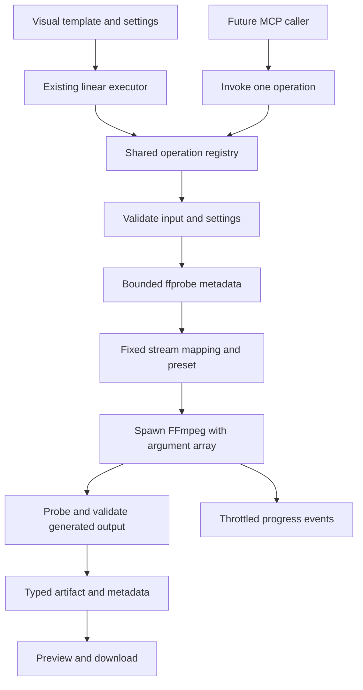

# Audio and video pipeline design

Status: original design proposal and future extensions. A first implementation now supports audio conversion/trimming, video trimming/audio extraction, playback/download, and local MCP calls. The current operation settings and limits are documented in [README.md](../README.md) and [MCP.md](../MCP.md); the additional operations, profiles, provenance, and progress described below remain proposals. This proposal follows the original FlowKit plan: one input, a connected linear chain, shared operations, and optional transcription/RAG later.

## FFmagic inspiration

Reference: [puchic/ffmagic](https://github.com/puchic/ffmagic), inspected in the local `archieve/ffmagic` checkout. This comparison describes the local source; upstream may differ.

| Observed in FFmagic | Proposed FlowKit application |
| --- | --- |
| `ui.py`: choose files and describe a task | Audio/video templates, compatible nodes, and settings for ranges and output profiles |
| `ffmagic.py`: display generated commands before running | Show the selected operations, settings, and output format before Run; put command details in diagnostics |
| `ffmagic.py`: execute sequentially and stop on failure | Reuse the linear executor; retain completed outputs and skip downstream nodes |
| `ffmpeg_core.py`: elapsed-time progress bar | Probe duration first, then consume FFmpeg's structured progress channel |
| `ai.py` and `ffmagic.py`: model-generated corrections and retries | Structured errors and suggested settings changes; explicit reruns use validated operation contracts |
| `utils.py`: open the output in a player | Inline audio/video playback and download |
| `ffmpeg_core.py`: execution logs | Bounded, redacted diagnostics and timings, separate from binary artifacts and model context |

FlowKit constructs fixed argument arrays for predefined operations. Normal transformations require no model call or generated script. Future natural-language input may select an existing operation and validated settings, preserving the goal of reducing repeated code-generation tokens.

The local FFmagic implementation uses shell execution, free-form generated commands, and model-based retries. Those implementation choices are not proposed here. Multi-file merging, overlays, and picture-in-picture also require input/graph capabilities outside the current one-input MVP.

## Initial templates

Each line is an independent linear workflow. Inspection attaches metadata and passes the media onward. Preview is terminal and provides playback/download.

```text
Prepare audio
audio.upload → audio.inspect → audio.trim → audio.normalize → audio.preview

Convert audio
audio.upload → audio.inspect → audio.trim → audio.convert → audio.preview

Extract audio from video
video.upload → video.inspect → video.trim → video.extractAudio → audio.preview

Make a video clip
video.upload → video.inspect → video.trim → video.convert → video.preview
```

The initial trim range must be visible before Run and can be changed or removed for short files. Never silently discard an uploaded file's ending. If the output exceeds a duration/size limit, ask for a shorter range or smaller profile.

After a transcription adapter exists:

```text
audio.upload → audio.inspect → audio.trim → audio.convert(speech) → audio.transcribe → transcript.preview

video.upload → video.inspect → video.trim → video.extractAudio(speech) → audio.transcribe → transcript.preview
```

Transcription needs a separately configured speech-to-text engine/provider. FFmpeg preprocessing alone does not produce a transcript. Timestamped transcript records can later feed the shared chunking/retrieval/cited-answer nodes. Transcript-only answers do not describe silent scenes or other visual semantics.

Keyframe extraction can follow as a separate template ending in a frame-gallery preview. It returns a frame collection rather than a video, and does not introduce branching or an automatic vision-model call.

## Operation contracts

Use the existing `OperationRegistry` validators and `{ type, value }` envelope. Audio and video remain distinct types because each registered operation currently declares a single input/output type. Share probing and execution internally.

| Operation | Input → output | Exposed settings and behavior |
| --- | --- | --- |
| `audio.upload` | audio → audio | MP3/WAV bytes initially; validate extension/signature, demuxer, and usable audio stream |
| `video.upload` | video → video | MP4 bytes initially; require a real video stream, excluding attached cover art |
| `audio.inspect` | audio → audio | No options; duration, codec, channels, sample rate, and stream index |
| `video.inspect` | video → video | No options; duration, audio/video streams, dimensions, frame rate, and rotation |
| `audio.trim` | audio → audio | Finite `startSeconds >= 0` and `endSeconds > startSeconds`, within input duration; re-encode into a documented intermediate audio format |
| `video.trim` | video → video | Same range checks; accurate decoded/re-encoded clip, audio retained when present, output timelines reset |
| `video.extractAudio` | video → audio | Enumerated audio profile; explicit stream selection; reject missing audio |
| `audio.convert` | audio → audio | Profile enum: `speech-wav` or `listen-mp3`; server-owned codec/sample-rate/channel/bitrate settings |
| `audio.normalize` | audio → audio | Profile enum: `speech` or `listening`; fixed loudness target/true-peak limit and two-pass measurement for files |
| `video.convert` | video → video | Profile enum: `web-720p`; H.264/AAC MP4, preserved aspect ratio, even dimensions, bounded frame rate, no upscaling |
| `audio.preview` | audio → audio | No options; playback, metadata, download |
| `video.preview` | video → video | No options; playback, metadata, download |

Proposed audio outputs: `speech-wav` is 16 kHz mono PCM16 WAV; `listen-mp3` is 44.1 kHz stereo MP3 at a fixed bitrate. Normalization is optional and does not promise better transcription. Give it a fixed documented output format. Before implementation, record exact codecs, bitrates, loudness targets, and intermediate formats in a shared server-owned preset table.

Check encoder/filter availability in the actual FFmpeg build. Missing codecs must produce a capability error. Accurate trimming is the initial contract; a later stream-copy mode must be labeled as approximate/keyframe-aligned and tested separately. Never silently substitute it when encoding fails.

## Execution and artifact model



Proposed modules:

- `src/media/probe.mjs`: bounded JSON probing, metadata validation, and capability discovery.
- `src/media/runner.mjs`: executable discovery, process lifecycle, progress, deadlines, cancellation, and bounded diagnostics.
- `src/media/presets.mjs`: fixed codecs, mappings, formats, filters, and limits.
- `src/media/audio.mjs` and `src/media/video.mjs`: individual operation validators/adapters.

Every operation must also work through `registry.execute` without a preceding visual inspect node. Probe internally when necessary. Cache metadata only for immutable bytes/artifacts within a job; browser-supplied metadata never bypasses validation.

Initially retain the byte-based payload: `name`, binary `data`, `mimeType`, `source`, duration, selected streams, and source-timeline provenance. Keep bytes out of progress events. Return the final small artifact as base64 once, as the image API does, and metadata for intermediate nodes. Do not serialize Buffer arrays or duplicate binary content per node.

Larger media requires an artifact store with session-scoped opaque IDs, expiry, and byte/range downloads. Resolve references only within their owning session/job; accept no host paths from the browser or future MCP callers. Playback/download routes need the same ownership checks. Artifact transport is a separate prerequisite for larger cloud workflows.

## Progress and failures

Use FFmpeg's [`-progress`](https://www.ffmpeg.org/ffmpeg.html) channel with a private output file. Parse complete key/value records across chunk boundaries, tolerating unknown fields. Calculate progress from processed output time and the selected interval. Two-pass normalization exposes separate measurement and encoding phases.

```json
{
  "type": "node.progress",
  "nodeId": "extract-audio",
  "phase": "encoding",
  "processedSeconds": 6.2,
  "totalSeconds": 10,
  "progress": 0.62
}
```

This is a proposed event extension. Add an optional operation-progress callback through the registry/executor. The client needs an explicit handler because it currently derives status from event suffixes; progress must leave the node running. Throttle updates, clamp percentages, and show indeterminate progress for unknown duration. Only successful exit plus output verification completes a node, even if FFmpeg reports its progress stream ended.

The `AbortSignal` covers probing, every normalization pass, encoding, verification, and reads. On cancellation, disconnect, or timeout, terminate the process, await its exit, remove partial files, and skip downstream nodes. Test this on Windows and Linux.

Return stable codes such as `UNSUPPORTED_MEDIA`, `NO_AUDIO_STREAM`, `INVALID_RANGE`, `CODEC_UNAVAILABLE`, `RESOURCE_LIMIT`, `TIMEOUT`, and `CANCELLED`, a concise explanation, and a suggested action. Keep full native logs out of the normal UI/model context. Invalid arguments, corrupt input, missing streams, and missing codecs are not retried automatically. Any later transient-error retry must name its conditions, cap attempts, and honor cancellation.

## Source timestamps

Trim settings are relative to the current input. Every result also records its original-source interval: trimming source seconds 30–40 and then local seconds 2–6 yields source seconds 32–36. Playback starts at zero; future transcript citations retain original-source timestamps. Time-preserving conversion and normalization retain the mapping.

Speed changes and silence removal need a piecewise mapping before citations remain trustworthy. Defer them from the first slice.

## Proposed limits and deployment

These are starting proposals to validate against the fixtures, not current capabilities:

| Boundary | Initial proposal |
| --- | --- |
| Local input | 20 MiB per file, preserving the existing upload cap |
| Probed source | At most 10 minutes; video at most 1920 × 1080 and 60 fps |
| Selected transform interval | At most 120 seconds, explicitly chosen by the user |
| Generated output | 8 MiB; suggest a shorter interval/smaller profile when exceeded |
| Probe | 10-second deadline and bounded JSON/log output |
| Whole operation | 120-second deadline across all subprocesses, including both normalization passes |
| Execution | One job per instance; at most two codec threads; explicit worker CPU, memory, and temporary-disk quotas |

Enforce byte quotas during processing and independently validate output duration/resolution. FFmpeg file-size options alone do not prove a complete artifact: output truncated by a limit must fail verification. Resource limits may reject an input below the nominal file/duration caps.

The current base64 path has a smaller cloud upload limit; see [DEPLOYMENT.md](../DEPLOYMENT.md). Larger supplied fixtures can be local-only. Do not raise the advertised cloud limit without changing transport. Request-bound execution and per-instance concurrency remain demo constraints; larger/longer cloud media needs direct artifact uploads, durable jobs, and a bounded worker.

Use trusted `FFMPEG_PATH` and `FFPROBE_PATH` settings with PATH fallback. Install both tools in Docker/CI, record versions/capabilities, and verify the presets there. Add tiny audio-conversion and video-to-audio smoke tests before promotion. Review the distributed build and codec licensing during packaging.

Use private filenames, fixed arguments with `shell: false`, and no stdin prompts. Restrict demuxers/protocols to the supported formats and local files; exclude playlists, network URLs, raw flags/filter graphs, scripts, and external-file references. Bound and isolate probing as well as decoding. Preserve originals and delete temporary data on every terminal path.

## Validation using test_files

The local collection is `../test_files/` relative to the app. Keep large/user-provided assets local; generate small fixtures for CI.

| Supplied fixture | Intended check |
| --- | --- |
| `Audio/sample.mp3` | Inspect, select a short interval, normalize/convert, play, download |
| `Audio/acoustic_kick_drum_sample.wav` and `acoustic_snare_drum_sample.wav` | Very short clips, full-range handling, channel/sample-rate behavior; no transcript assumptions |
| Both `Audio/soundhelix_*.mp3` files | Probe actual duration; check source limits, selected short ranges, output caps, cancellation |
| `Videos/sample.mp4` | Inspect, trim, extract audio when present, independently validate outputs |
| `Videos/Me at the zoo [jNQXAC9IVRw].mp4` | Candidate speech clip; inspect/play before defining future transcription assertions |
| `Videos/Shortest Video on Youtube [tPEE9ZwTmy0].mp4` | Very short duration, end bounds, missing-stream behavior based on actual probe results |
| `Videos/Get Stick Bugged lol [fC7oUOUEEi4].mp4` and all three Caminandes clips | Codec/dimension variations, spaces/brackets in filenames, selected intervals, limits |

First generate a local ffprobe manifest containing stream types/codecs, dimensions, duration, channels, and sample rate. Do not infer those properties or transcript text from names. Assign each supplied file an expected successful transformation or specific limit rejection; do not silently skip fixtures.

Adapter tests cover invalid/spoofed/truncated input, absent audio, cover-art streams, ranges, output caps, missing executables/codecs, progress chunking, cancellation during each pass, deadlines, and cleanup. Independently probe each output for codecs, dimensions, duration tolerance, channels/sample rate, and stream selection. For normalization, measure output loudness on an appropriate non-silent signal with a documented tolerance; explicitly handle silence/undefined measurements.

Browser tests cover template choice, upload, metadata, settings, live progress, cancellation, playback, and downloaded bytes. Preserve the document/image suites. Test provenance through two successive trims. Token-saving claims require a separate benchmark of model/schema tokens, retries, runtime, and output correctness; presets alone do not justify a percentage claim.

## Implementation order

1. Shared probe/runner and capability discovery, including process cleanup, limits, and progress tests.
2. First audio slice: MP3/WAV upload, inspect, range selection, conversion, playback/download, and supplied-file verification.
3. Video inspect/accurate trim, audio extraction, and MP4 conversion; verify absent audio, rotation, A/V alignment, and artifacts.
4. Two-pass normalization with phase-aware progress; media smoke tests and Docker/CI verification.
5. Artifact transport/durable jobs before larger cloud workflows; then transcription with timestamped records, optional RAG, and a separate MCP adapter over the same operations.

Use a separate feature branch per slice and open PRs back to `main`. Include what changed, exact tests/results, supported limits, and remaining gaps. Review before merging. Releases are manual and separate from merging; see [DEPLOYMENT.md](../DEPLOYMENT.md).

## References

- [FFmagic](https://github.com/puchic/ffmagic): interaction, sequential execution, progress, playback, and error-loop inspiration; no source code copied.
- [FFmpeg command documentation](https://www.ffmpeg.org/ffmpeg.html): progress, mappings, seeking, encoding.
- [ffprobe documentation](https://ffmpeg.org/ffprobe.html): structured container/stream metadata.
- [loudnorm documentation](https://ffmpeg.org/ffmpeg-filters.html#loudnorm): file-based loudness measurement/normalization.
- Local `archieve/archieve/PLAN.md` and `DIAGRAMS.md`: original FlowKit scope, content records, and editor/MCP separation. The ignored archive is not required in a clone.
